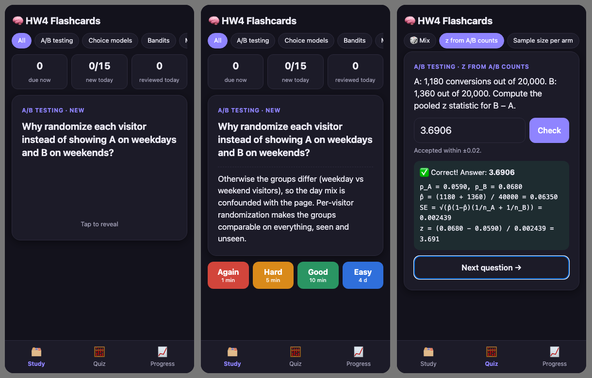

# HW4 Flashcards 🧠

A single-file, phone-friendly study app for DSO 429 HW4:
- **80 flashcards** on concepts and formulas
- **spaced repetition**, so cards you miss come back sooner
- a **quiz mode** whose calculation questions use new random numbers every time, with worked solutions
- progress saved in `localStorage`



## Use it

Open `index.html`. It's one file with no dependencies, so you can also save it to your phone's home screen. There are three tabs:

- **🗂️ Study.** Tap to reveal, then rate the card: **Again** (back in 1 min), **Hard**, **Good** (10 min → 1 day → about 2.5× longer each time) or **Easy** (4+ days). Each button shows its next interval. You get 15 new cards a day, and "Study 10 more" adds more. You can filter by topic (A/B testing 20, Choice models 16, Bandits 14, Machine learning 30), and on a computer keys 1–4 rate a card.
- **🧮 Quiz.** 12 calculation drills, or 🎲 Mix: z from A/B counts, sample size per arm, payback days, CI half-width, logit share, WTP, precision/recall, break-even cutoff, regret of a test, ε-greedy P(leader), Beta posterior mean, and AUC by pair counting. Type a number and get ✅/❌ plus the full worked solution.
- **📈 Progress.** Cards seen, "solid" cards (intervals of 7+ days) and cards due, by topic; quiz accuracy per drill; and a day streak.

## Files

| File | Role |
|---|---|
| `index.html` | **the app** (single file, built) |
| `cards.js` | the 80 cards (source) |
| `app_template.html` | app source; `build.py` inlines the cards into it to make `index.html` |
| `test.mjs` | tests |

```
python3 build.py && node test.mjs
```

## Tests (`test.mjs`, 26 checks)

- **Cards:**
  - 80 unique cards in four topics, with no thin or duplicate cards
  - the numbers quoted on cards are recomputed: WTP $28.07, P(leader) 0.867, break-even 0.625, SD 13.4
- **Scheduling:**
  - first intervals run again < hard < good < easy
  - repeated "good" grows the interval (10 min → 1 d → 2.5 d → 6.3 d → 16 d)
  - "again" resets a mature card and lowers its ease, which never drops below 1.3
- **Review order:** a missed card is due after 2 minutes while a known one isn't, the most overdue card comes first, and the daily new-card limit holds.
- **Every drill:** 300 random questions each, with **the answer recomputed independently from the question text** (12/12 drills exact). Correct answers are accepted and wrong ones rejected, and input like "$1,234.5" or "45%" parses.

The tests caught two bugs during development: the generators weren't passing their random-number source (no drill could have run), and five cards had one-word fronts.
